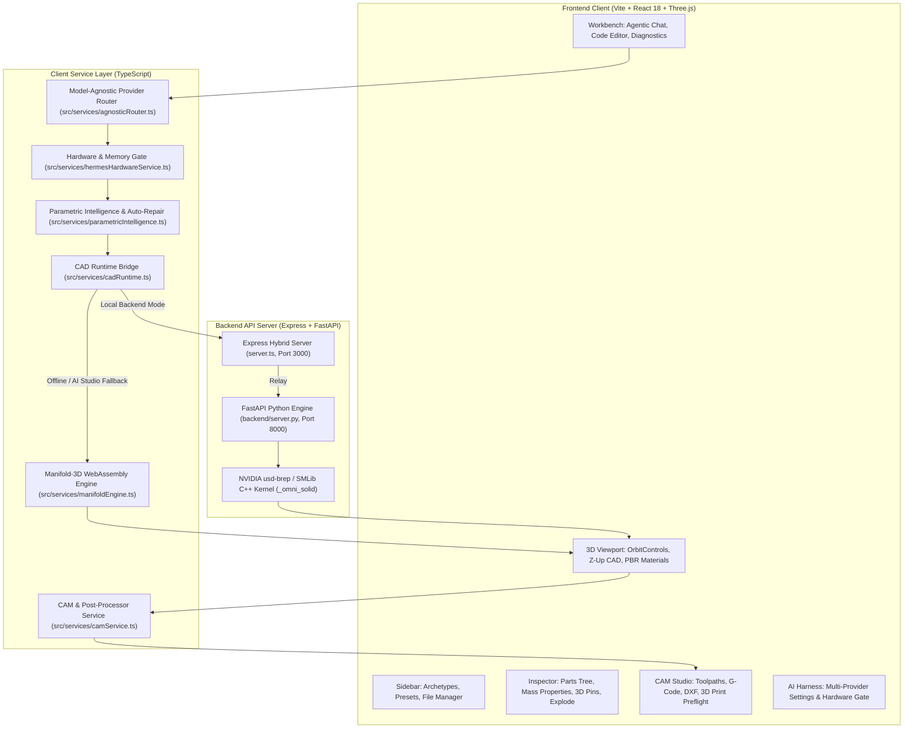

# Agentic CAD Studio — Architecture Specification & Engineering Plan

## 1. Deep Research & Foundational Technologies

### 1.1 NVIDIA `usd-brep` (`NVIDIA-Omniverse/usd-brep` v1.0.0)
- **What It Is**: NVIDIA Omniverse's standalone C++ and Python library (`usd-brep==1.0.0`, CPython 3.12) for exact **NURBS-based Boundary Representation (BRep)** solid modeling (`SMLib` / `SM_API` / `_omni_solid` / `usd_brep`) with native OpenUSD (`BrepArray` and `UsdGeom.Mesh`) import and export.
- **Bundled Runtime**: The PyPI wheel (`pip install usd-brep` on CPython 3.12) bundles its own OpenUSD 25.11 runtime and the `omniSolid` schema (`BrepArray`), requiring zero external Omniverse Kit installation.
- **Canonical Agent Workflow (`.agents/docs/generate_asset.md` & `tools/scripts/example_generate_asset.py`)**:
  1. Author parametric `build_parts()` returning `list[dict(name, brep, color, kind)]` using `usd_brep` (`import usd_brep as sm`).
  2. Validate each part using `brep.is_manifold_solid()`, `brep.volume()`, `brep.material_census()`, `brep.info()`, and pairwise `sm.brep_relationship(a, b)` / `sm.brep_distance(a, b)`.
  3. Tessellate exact NURBS BReps via `sm.tessellate(brep, chord_height_tolerance=..., curve_angle_tolerance_deg=..., surface_angle_tolerance_deg=...)` into `PolyBrep` and extract mesh buffers via `PolyBrep.to_mesh_arrays()`.
  4. Run NVIDIA's multi-part sanity checks (`sanity_checks()` from `.agents/docs/generate_asset.md` §13) for gross interpenetration against anchor parts and envelope containment breaches.
  5. Export:
     - **Canonical Mesh-Only OpenUSD (`.usda`)** with `upAxis = "Z"`, `metersPerUnit = 0.01`, root `/<AssetName>` `Xform`, per-part `UsdGeom.Mesh` prims, `primvars:displayColor`, and `custom token asset:kind`.
     - **Exact NURBS `BrepArray` OpenUSD (`.brep.usda`)** via `sm.usd.export_brep()` / `sm.usd.export_breps()` for lossless downstream CAD operations.
     - **Binary/ASCII `.stl` and `.obj`** for 3D printing and universal 3D viewers.

### 1.2 Survey of Existing Agentic CAD Repositories
| Repository | Core Stack | Key Takeaway Adopted in This Project |
|---|---|---|
| **`NVIDIA-Omniverse/usd-brep`** | `usd_brep` (`_omni_solid`) C++ NURBS kernel + OpenUSD `BrepArray` | **Used directly** as our primary Python 3.12 BRep modeling, tessellation, topology/manifold querying, and OpenUSD export engine, along with NVIDIA's official `.agents/` operation guides and `example_generate_asset.py` contract. |
| **`NVIDIA-Omniverse/usd-convert-cad`** | `usd-convert-cad` wheel + CAD-to-USD agent skill | Adopted the **CLI/subprocess exit-code + structured diagnostic contract** and OpenUSD stage metadata conventions (`upAxis="Z"`, `metersPerUnit=0.01`). |
| **`cyberchitta/cad-khana`** | `build123d` + diagnostics-first CLI | Adopted the **diagnostics-first feedback loop**: every run checks manifoldness, volume, void cavities (`material_census`), pairwise clearance/interpenetration (`brep_relationship`), and bounding-box sanity checks (`sanity_checks`) so the LLM agent self-corrects without human babysitting. |
| **`jdilla1277/agentcad`** | `build123d` / `CadQuery` + JSON stdout contract + live browser viewer | Adopted the **structured JSON execution response** (stdout JSON separate from kernel logs) and **versioned A/B build history** with instant browser 3D preview. |
| **`kreuzhofer/chat3d-app`** | React + TypeScript + Vite + Three.js + multi-step LLM pipeline | Adopted the **Three-Pane Workspace UI** (Preset/History Sidebar, Agentic Chat + Code & Diagnostics Workbench, Interactive Three.js 3D Viewport). |

---

## 2. System Architecture & Dual-Runtime Solid Modeling

To satisfy both:
1. **Real NVIDIA `usd_brep` execution** (using the official CPython 3.12 `usd-brep==1.0.0` C++ kernel on supported platforms), and
2. **Seamless Google AI Studio & Browser compatibility** (where AI Studio imports the GitHub repo as a Vite + React + TypeScript project running inside a browser preview sandbox),

we use a **Dual-Runtime Hybrid Architecture** backed by an in-browser WebAssembly CSG engine and a model-agnostic AI copilot:



---

## 3. Core Subsystems

### 3.1 Model-Agnostic Copilot & Hardware Gate
- **Providers Supported**: Google Gemini 3.8 Flash, local Ollama socket (`http://127.0.0.1:11434`), LM Studio (`http://127.0.0.1:1234`), vLLM, Groq, Together AI, OpenAI, and Hugging Face Hub live GGUF model explorer.
- **Hardware Gating (`canRunOnSystem()`)**: Evaluates host CPU cores, RAM, and WebGPU VRAM. Strictly enforces a **1.5 GB memory reservation** for Three.js geometry and WebAssembly buffers, preventing host OOM system freezes.
- **Connection Probing (`testOnly` mode)**: Verifies socket connectivity before routing prompts to prevent cryptic synthesis aborts.

### 3.2 Dual Solid Modeling Kernels
- **Native B-Rep (`usd-brep`)**: Exact NURBS surfaces, circular filleting, sweeps, boolean operations, OpenUSD `BrepArray` export, and tolerance-controlled tessellation.
- **Client-Side CSG (`manifold-3d` Wasm)**: Client-side Constructive Solid Geometry engine running in WebAssembly. Generates guaranteed watertight 2-manifold output, exact outward normal STL exports, and individual part downloads with 0-crash offline reliability.

### 3.3 Native CAM, G-Code & Digital Fabrication Studio
- **Toolpaths**: 2D Contour Profiling with cutter radius compensation (`G41`/`G42`), Pocket Clearing with raster/concentric stepovers, Waterline Z-Level Roughing, and Ballnose Surface Finishing.
- **CNC G-Code**: RS-274 / LinuxCNC standard output with configurable feed rates, spindle RPM, and rapid clearance planes (`G00 Z5.0`).
- **2D DXF**: AutoCAD R12 DXF polyline cut-sheet generation for CNC laser, plasma, and waterjet machines.
- **3D Printing Preflight**: Automated slicing estimation, layer counting ($0.12 - 0.28\text{ mm}$), print duration, and filament weight computation.

### 3.4 Engineering Inspector & CAD File Manager
- **Docked Multi-Tab Sidebar**:
  - **Parts Tree**: Per-part visibility toggle, single-click isolation, and synchronized multi-layer renaming (Python code, OpenUSD prims, 3D pins).
  - **Mass Properties**: Physical volume, bounding dimensions, mass, and 3D Center-of-Mass (CoM) marker for 8 PBR industrial materials.
  - **3D Annotations Dock**: Interactive vertex-snapped annotation pins with leader lines, resolution tracking, and camera focus.
  - **Explosion Timeline**: Keyframe-scrubbed assembly disassembly animation.
- **CAD File Retention**: Versioned design retention across localStorage and optional Firestore cloud storage.

---

## 4. Testing, TDD & CI Verification Matrix

The repository maintains **155 frontend unit and integration tests across 14 test suites** (100% pass rate in ~1.1s), backend Python pytest tests, and headless Chrome browser automation:

```bash
# 1. Frontend Unit Tests (Vitest — 155 tests across 14 test suites)
npm test

# 2. TypeScript Static Analysis (0 errors)
npm run lint

# 3. Production Bundle Build (Vite)
npm run build

# 4. Headless Chrome CDP Verification (9 DOM/ARIA & Viewport scenarios)
npm run test:browser

# 5. Python Backend Engine Verification
pytest backend/test_cad_engine.py -v
```

### CI/CD Automation Matrix (`.github/workflows/ci.yml`)
1. **`security-audit`**: Pattern scanning over all tracked git files to guarantee 0 leaked credentials or private keys.
2. **`frontend-ci`**: Node 20 environment, `npm run lint` typecheck, `npm test` Vitest suite, and `npm run build` production bundling.
3. **`backend-ci`**: Python 3.12 environment, `pip install -r backend/requirements.txt`, and pytest engine verification.

---

## 5. Security & Secret Management Policy

- **Zero Tracked Secrets**: All configuration manifests (`firebase-applet-config.json`, `.firebaserc`) contain zero hardcoded credentials or API keys.
- **Environment Isolation**: Dynamic injection via `.env` (`GEMINI_API_KEY`, `VITE_FIREBASE_API_KEY`).
- **Safe Offline Fallback**: Dummy fallback credentials protect against module-load crashes (`auth/invalid-api-key`) when running in offline or unconfigured environments.
- **Automated CI Enforcement**: Verified on every push and pull request via the GitHub Actions `security-audit` job.
