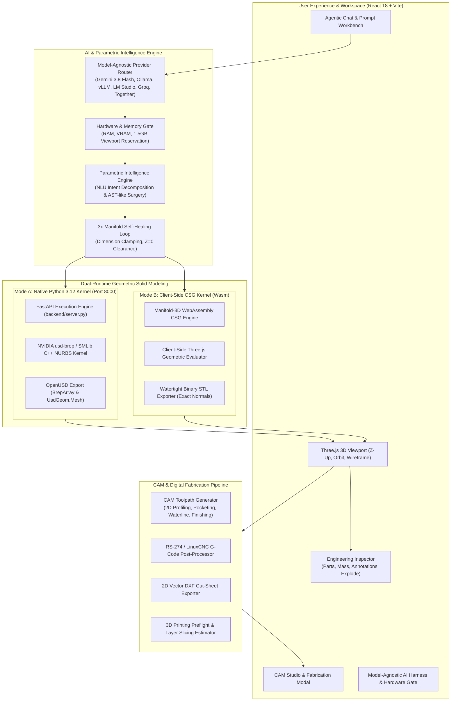

# ApexCAD Studio — System Architecture Specification

## 1. Executive Architecture Overview

ApexCAD Studio is an **Agentic Boundary Representation (B-Rep) and Constructive Solid Geometry (CSG) Computer-Aided Design (CAD) Studio**. It bridges high-level natural language prompt engineering, AI provider orchestration, exact solid modeling kernels, and digital manufacturing toolchains (CAM, G-Code, DXF, OpenUSD, STL).

---

## 2. Layer-by-Layer Architectural Breakdown

### 2.1 Layer 1: Model-Agnostic AI Provider Router & Hardware Gate

Located at [`src/services/agnosticRouter.ts`](file:///Users/jimmy/Documents/Repos/CAD-Agentic/src/services/agnosticRouter.ts) and [`src/services/hermesHardwareService.ts`](file:///Users/jimmy/Documents/Repos/CAD-Agentic/src/services/hermesHardwareService.ts).

1. **Provider Independence**:
   - **Google Gemini**: Uses `@google/genai` with `gemini-3.8-flash` cascading to `gemini-2.5-pro` for deep parametric design.
   - **Local Socket Engines**: Connects directly to local Ollama (`http://127.0.0.1:11434`), vLLM (`http://127.0.0.1:8000/v1`), or LM Studio (`http://127.0.0.1:1234/v1`).
   - **Cloud OpenAI-Compatible APIs**: Routes to Groq (`api.groq.com`), Together AI (`api.together.xyz`), or OpenAI (`api.openai.com`).
   - **Hugging Face Hub Live Explorer**: Live repository search for GGUF quantizations (`Q4_K_M`, `Q8_0`, `FP16`) via server proxy.

2. **True-to-System Hardware Gating (`canRunOnSystem()`)**:
   - Evaluates system RAM, CPU logical cores, and WebGPU VRAM.
   - Enforces a **1.5 GB memory reservation** dedicated to the Three.js 3D viewport and Manifold WebAssembly buffers.
   - Prevents host Out-Of-Memory (OOM) lockups by gating models whose memory footprint exceeds available system headroom:
     $$\text{Estimated RAM (GB)} = \frac{\text{Parameters (B)} \times \text{Bits per Weight}}{8 \times 10^9} + 1.25\text{ GB (Context Buffer)}$$
   - Flags execution warnings if estimated token generation throughput falls below $4\text{ tokens/sec}$ or memory saturation exceeds $95\%$.

---

### 2.2 Layer 2: Parametric Intelligence & Self-Healing Loop

Located at [`src/services/parametricIntelligence.ts`](file:///Users/jimmy/Documents/Repos/CAD-Agentic/src/services/parametricIntelligence.ts) and [`src/services/geminiAgent.ts`](file:///Users/jimmy/Documents/Repos/CAD-Agentic/src/services/geminiAgent.ts).

1. **Natural Language Intent Decomposition**:
   - Parses engineering modifications from natural language (e.g., "enlarge bore to 25mm", "bore 4 mounting holes through flanges", "scale height by 1.5x", "remove internal ribs").
   - Identifies operations: `SCALE_DIMENSION`, `BORE_HOLE`, `ADD_FEATURE`, `ROTATE_AXIS`, `TRANSLATE_OFFSET`, `DELETE_PART`.

2. **AST-Like Script Surgery**:
   - Operates on both Python `usd_brep` syntax (`sm.make_cylinder(...)`, `sm.boolean_difference(...)`) and client-side geometric generator definitions.
   - Performs clean parameter substitution while maintaining syntactic validity and import statements.

3. **Autonomous 3-Stage Manifold Self-Healing**:
   - If a solid operation produces an unclosed or non-manifold mesh, non-positive volume, or interpenetration breach:
     - **Stage 1 (Dimension Clamping)**: Adjusts degenerate parameters ($d \le 0$) to minimum physical thresholds ($1.0\text{ cm}$) while preserving origin coordinate tuples.
     - **Stage 2 (Penetration Clearance Elevation)**: Preserves ground-plane anchors ($z=0$) while adjusting upper stacked components upward to clear interpenetration collisions.
     - **Stage 3 (Boolean Re-Ordering)**: Re-sequences union and difference trees to eliminate self-intersecting coplanar faces.

---

### 2.3 Layer 3: Dual-Runtime Geometric Solid Modeling Kernels

ApexCAD Studio employs a dual-runtime strategy to eliminate crashes across different operating systems and deployment environments.

#### Mode A: Native Python 3.12 B-Rep Kernel (`usd-brep`)
- **Backend Service**: FastAPI server at [`backend/server.py`](file:///Users/jimmy/Documents/Repos/CAD-Agentic/backend/server.py) and [`backend/cad_engine.py`](file:///Users/jimmy/Documents/Repos/CAD-Agentic/backend/cad_engine.py).
- **Core Engine**: NVIDIA's `usd-brep==1.0.0` C++ solid modeling library (`_omni_solid` / `SMLib`).
- **Capabilities**:
  - Exact analytic NURBS surface evaluation.
  - Boolean operations (`union`, `difference`, `intersection`).
  - Circular edge and vertex filleting (`sm.fillet()`).
  - Swept solids along 3D space curves (`sm.sweep()`).
  - Native OpenUSD stage serialization (`sm.usd.export_brep()` into `BrepArray`).
  - Tessellation into `PolyBrep` mesh arrays with chord-height tolerance controls.

#### Mode B: Client-Side WebAssembly CSG Kernel (`manifold-3d`)
- **Engine**: WebAssembly build of `manifold-3d` via [`src/services/manifoldEngine.ts`](file:///Users/jimmy/Documents/Repos/CAD-Agentic/src/services/manifoldEngine.ts).
- **Zero-Crash Resilience**: Runs 100% in-browser on macOS Apple Silicon, Windows, Linux, and Google AI Studio iframe previews without requiring a local Python C++ environment.
- **Capabilities**:
  - Watertight polygon mesh booleans with guaranteed 2-manifold output.
  - Computes exact outward facet normals for clean 3D printing slicing.
  - Generates binary and ASCII `.stl` files directly from memory buffers.
  - Supports individual part isolation and per-part download.

---

### 2.4 Layer 4: CAM, Toolpathing & Manufacturing Pipeline

Located at [`src/services/camService.ts`](file:///Users/jimmy/Documents/Repos/CAD-Agentic/src/services/camService.ts) and [`src/services/dxfExporter.ts`](file:///Users/jimmy/Documents/Repos/CAD-Agentic/src/services/dxfExporter.ts).

1. **Toolpath Generation Modes**:
   - **2D Contour Profiling**: Follows outer part silhouettes with cutter radius compensation (`G41`/`G42`).
   - **Pocket Clearing**: Raster zig-zag and concentric offset clearing of internal cavities with stepover control.
   - **Waterline Z-Level Roughing**: Slices 3D geometry into discrete horizontal $Z$ planes with incremental stepdown.
   - **Ballnose 3D Surface Finishing**: Scans continuous complex curved surfaces for high surface finish.

2. **CNC G-Code Post-Processor**:
   - Produces standard RS-274 / LinuxCNC compliant G-code:
     - Rapid positioning: `G00`
     - Linear feed moves: `G01`
     - Arc interpolation: `G02` (CW), `G03` (CCW)
     - Spindle and coolant controls: `M03`, `M05`, `M08`, `M09`, `M30`
   - Incorporates tool diameter, spindle RPM, plunge feed rate, and cutting feed rate parameters.

3. **2D Vector DXF Cut-Sheet Exporter**:
   - Projects 3D B-Rep horizontal cross-sections onto 2D $XY$ plane.
   - Outputs industry-standard AutoCAD Release 12 (R12) DXF with `ENTITIES` section containing `LINE` and `POLYLINE` blocks for laser, plasma, and waterjet cutters.

4. **3D Printing Preflight & Slicing Estimator**:
   - Analyzes watertight manifoldness, overhang angles ($>45^\circ$), and bounding volume.
   - Computes layer counts for $0.12\text{ mm}$, $0.20\text{ mm}$, and $0.28\text{ mm}$ layer heights.
   - Estimates print duration, filament mass (grams), and bed temperatures based on material presets.

---

### 2.5 Layer 5: Interactive 3D Viewport & Engineering Workspace

Located at [`src/components/Viewport3D.tsx`](file:///Users/jimmy/Documents/Repos/CAD-Agentic/src/components/Viewport3D.tsx) and [`src/App.tsx`](file:///Users/jimmy/Documents/Repos/CAD-Agentic/src/App.tsx).

- **Three.js Z-Up Coordinate System**: Matches standard CAD conventions ($Z$ pointing upward, $XY$ ground plane).
- **Interactive OrbitControls**: Smooth dampening, pan, zoom, and orthographic camera views (Top, Front, Right, Isometric).
- **Physical PBR Rendering**: Realistic metallic and dielectric materials with roughness, normal maps, and ambient occlusion.
- **Docked Tabbed Inspector**:
  - **Parts Tree**: Per-part visibility toggle, isolation mode, and synchronized multi-layer renaming.
  - **Mass Properties Calculator**: Dynamic center-of-mass (CoM) marker, volume, and mass for 8 industrial materials.
  - **3D Annotations Dock**: Interactive vertex-snapped annotation pins with leader lines and camera focus.
  - **Explosion Timeline**: Keyframe-scrubbed assembly disassembly animation.

---

### 2.6 Layer 6: In-App Agent Tools & API Automation

Located at [`src/services/appToolsAndSkills.ts`](file:///Users/jimmy/Documents/Repos/CAD-Agentic/src/services/appToolsAndSkills.ts) and [`server.ts`](file:///Users/jimmy/Documents/Repos/CAD-Agentic/server.ts).

- **Tool Calling Catalog**: Agent tools registered for autonomous invocation:
  - `cad_synthesize_geometry`: Generates B-Rep CAD assets from prompts.
  - `cad_generate_cam_toolpaths`: Generates CNC toolpaths, G-code, and DXF profiles.
  - `cad_audit_topology`: Inspects manifoldness, volume, and clearances.
  - `cad_calculate_mass_properties`: Computes mass and CoM for specified materials.
  - `cad_export_artifact`: Exports USD, STL, DXF, or G-Code.
- **Backend Express API Routes**:
  - `POST /api/execute`: Relays Python CAD scripts to FastAPI backend.
  - `POST /api/agent/turn`: Multi-provider LLM inference endpoint with `testOnly` connectivity probe mode.
  - `GET /api/hardware/profile`: Returns host CPU cores, memory stats, and platform architecture.
  - `GET /api/huggingface/search`: Proxies Hugging Face Hub searches for local GGUF models.
