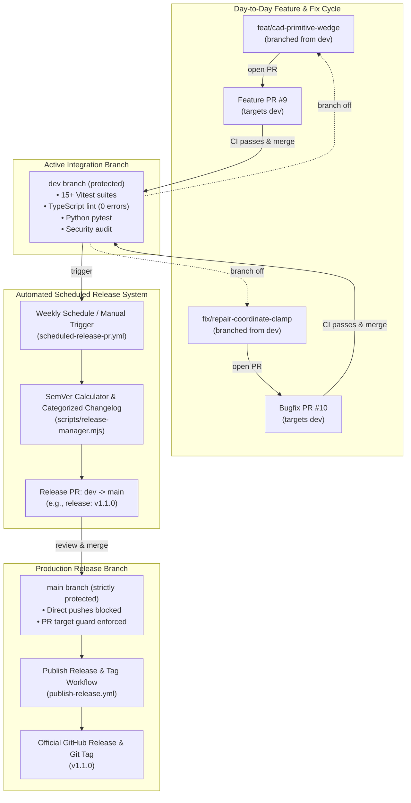

# ApexCAD Studio — Branching Strategy & Release Lifecycle Guide

## 1. Executive Summary

ApexCAD Studio enforces a **Structured Dual-Branch Git Flow**:
- **`main`**: The **Production Branch**. Direct commits to `main` are strictly prohibited. It only receives thoroughly verified code through formal **Scheduled Release PRs originating from `dev`** or emergency hotfixes.
- **`dev`**: The **Active Integration Branch**. All day-to-day feature work, bug fixes, performance optimizations, and documentation updates are developed in short-lived topic branches and merged into `dev` via Pull Requests.
- **Automated Scheduled Releases**: A GitHub Actions workflow runs on schedule (or manual trigger) to calculate Semantic Versioning (SemVer) based on Conventional Commits, update `CHANGELOG.md`, and open an automated Release PR from `dev` to `main`.
- **Automated Publishing**: Merging a release PR into `main` automatically tags the repository (`vX.Y.Z`) and publishes a GitHub Release with categorized release notes.

---

## 2. Branching Architecture & Lifecycle Diagram



---

## 3. Branch Taxonomy & Rules

| Branch Name | Purpose | Base Branch | Target PR Branch | Direct Commits Allowed? | Protection Status |
|---|---|---|---|---|---|
| **`main`** | Production releases | *None* | *None* | ❌ **PROHIBITED** | Required PR, Strict CI checks, Force Push / Deletion blocked |
| **`dev`** | Integration branch | `main` | `main` (Release PRs only) | ❌ **PROHIBITED** | Required PR, Strict CI checks, Force Push / Deletion blocked |
| **`feat/*`** | New features | `dev` | `dev` | ✅ Allowed on branch | Short-lived, deleted after merge |
| **`fix/*`** | Bug fixes | `dev` | `dev` | ✅ Allowed on branch | Short-lived, deleted after merge |
| **`refactor/*`** | Architectural cleanup | `dev` | `dev` | ✅ Allowed on branch | Short-lived, deleted after merge |
| **`hotfix/*`** | Emergency production fix | `main` | `main` & `dev` | ✅ Allowed on branch | Merged to `main` and back-merged to `dev` |

---

## 4. Developer Step-by-Step Workflow

### Step 1: Sync `dev` Branch Locally
Always start feature work from the latest `dev` branch:
```bash
git checkout dev
git pull origin dev
```

### Step 2: Create a Dedicated Feature or Fix Branch
```bash
# For a new feature:
git checkout -b feat/my-new-cad-feature

# For a bug fix:
git checkout -b fix/manifold-auto-repair
```

### Step 3: Develop with Test-Driven Development (TDD)
1. Write failing unit test in `src/**/*.test.ts`.
2. Implement code with inline comments.
3. Verify test pass rate:
   ```bash
   npm test
   npm run lint
   ```

### Step 4: Commit with Conventional Commits
Commit messages must follow the [Conventional Commits](https://www.conventionalcommits.org/) specification:
- `feat: add ballnose surface finishing toolpath` (triggers **minor** SemVer bump)
- `fix: resolve non-positive dimension clamping` (triggers **patch** SemVer bump)
- `feat!: redesign solid modeling kernel boundary schema` (triggers **major** SemVer bump)
- `chore: update dependencies` (triggers **patch** SemVer bump)
- `docs: update branching guide` (triggers **patch** SemVer bump)

```bash
git add .
git commit -m "feat(cam): add ballnose surface finishing toolpath"
git push -u origin feat/my-new-cad-feature
```

### Step 5: Open Pull Request Targeting `dev`
```bash
gh pr create \
  --base dev \
  --head feat/my-new-cad-feature \
  --title "feat(cam): add ballnose surface finishing toolpath" \
  --body "Summary of changes..."
```

> [!IMPORTANT]
> The PR target guard workflow ([`.github/workflows/pr-target-guard.yml`](file:///Users/jimmy/Documents/Repos/CAD-Agentic/.github/workflows/pr-target-guard.yml)) automatically blocks any feature PR attempting to target `main`. All development PRs must target `dev`.

### Step 6: Review, Merge & Branch Cleanup
Once CI status checks pass (`Secret & Credential Leak Audit`, `Frontend Lint, Test & Build`, `Python FastAPI Engine & Tests`), merge the PR into `dev` and delete the topic branch:
```bash
gh pr merge --squash --delete-branch
```

---

## 5. Automated Scheduled Release Workflow (`dev` -> `main`)

### 5.1 Automated Cadence
The workflow [`.github/workflows/scheduled-release-pr.yml`](file:///Users/jimmy/Documents/Repos/CAD-Agentic/.github/workflows/scheduled-release-pr.yml) runs automatically every **Monday at 00:00 UTC** and can also be triggered manually on-demand via GitHub Actions `workflow_dispatch`.

### 5.2 Release Generation Algorithm
1. **Divergence Detection**: Computes commits on `dev` ahead of `main` via `git rev-list --count origin/main..HEAD`.
2. **SemVer Calculation**:
   - Inspects all commits since the last release.
   - If any breaking change (`feat!:`, `BREAKING CHANGE`) is detected $\rightarrow$ **Major** bump.
   - If any `feat` commit is detected $\rightarrow$ **Minor** bump.
   - Otherwise $\rightarrow$ **Patch** bump.
3. **Changelog Assembly**:
   - Generates categorized markdown with sections for 🚀 Features, 🐛 Bug Fixes, ⚡ Performance, and 🛠️ Maintenance.
   - Prepends the release section to `CHANGELOG.md`.
4. **Automated PR Management**:
   - Updates `package.json` version.
   - Commits changes to `dev`.
   - Opens or updates a formal Pull Request from `dev` to `main` with the title `release: vX.Y.Z`.

### 5.3 Manual Release Check & Preview (Local CLI)
Developers can inspect pending releases locally at any time:
```bash
# Check if dev is ahead of main and preview the proposed version bump:
npm run release:check

# Preview formatted changelog markdown for pending commits:
npm run release:changelog

# Prepare and bump version locally:
npm run release:bump [auto|patch|minor|major]
```

---

## 6. Release Publishing & Tagging Workflow

When a `release: vX.Y.Z` pull request is approved and merged into `main`:
1. The workflow [`.github/workflows/publish-release.yml`](file:///Users/jimmy/Documents/Repos/CAD-Agentic/.github/workflows/publish-release.yml) triggers on push to `main`.
2. Extracts the version from `package.json`.
3. Verifies that git tag `vX.Y.Z` does not already exist.
4. Creates an annotated Git tag `vX.Y.Z` and pushes it to `origin`.
5. Extracts the corresponding changelog section from `CHANGELOG.md`.
6. Creates an official **GitHub Release** with release notes attached.

---

## 7. Emergency Hotfix Procedure

If a critical security vulnerability or blocking crash occurs in production:
1. Create a hotfix branch directly from `main`:
   ```bash
   git checkout main
   git pull origin main
   git checkout -b hotfix/critical-security-patch
   ```
2. Apply the fix and verify tests pass.
3. Open a PR targeting `main`:
   ```bash
   gh pr create --base main --head hotfix/critical-security-patch --title "fix(hotfix): critical security patch"
   ```
4. After merging to `main`, immediately back-merge `main` into `dev` to preserve synchronization:
   ```bash
   git checkout dev
   git pull origin dev
   git merge origin/main
   git push origin dev
   ```
