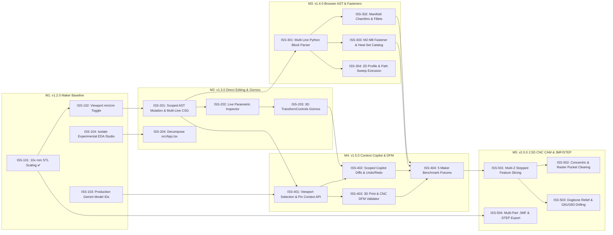

# ApexCAD Studio — Project Milestones, Epics, Sub-Issues & Dependency Tracker

This document is the authoritative **Issue, Sub-Issue, and Milestone Tracking Board** for **ApexCAD Studio** (`agentic-cad-usd-brep`). It is synchronized with [`scripts/project-issues-manifest.json`](../scripts/project-issues-manifest.json) and can be pushed to GitHub Milestones and Issues at any time via `npm run issues:sync` or the [`.github/workflows/sync-milestones-and-issues.yml`](../.github/workflows/sync-milestones-and-issues.yml) GitHub Action.

## 1. Cross-Milestone Dependency Graph (Critical Path)



## 2. Milestone Summary & Progress Rollup

| Milestone ID | Version | Milestone Title | Parent Epic | Sub-Issues | Target Due Date | Status |
| :--- | :--- | :--- | :--- | :--- | :--- | :--- |
| **M1** | `v1.2.0` | **True-Scale Maker Baseline & Honesty Pass** | `EPIC-1` | `ISS-101` ✅, `ISS-102`, `ISS-103`, `ISS-104` | `2026-11-15` | **In Progress (1/4 Done)** |
| **M2** | `v1.3.0` | **Precision Direct Editing, 3D Gizmos & Parametric Inspector** | `EPIC-2` | `ISS-201`, `ISS-202`, `ISS-203`, `ISS-204` | `2026-12-06` | Planned |
| **M3** | `v1.4.0` | **Structured Browser CAD Parser, Fillets/Chamfers & Fastener Library** | `EPIC-3` | `ISS-301`, `ISS-302`, `ISS-303`, `ISS-304` | `2026-12-27` | Planned |
| **M4** | `v1.5.0` | **Context-Aware Copilot (Click-to-Edit & DFM Auto-Repair)** | `EPIC-4` | `ISS-401`, `ISS-402`, `ISS-403`, `ISS-404` | `2027-01-17` | Planned |
| **M5** | `v2.0.0` | **2.5D Multi-Depth CNC CAM, Pocket Clearing & STEP / 3MF Interop** | `EPIC-5` | `ISS-501`, `ISS-502`, `ISS-503`, `ISS-504` | `2027-02-14` | Planned |

## 3. Detailed Epics, Sub-Issues & Linking Specifications

### Milestone M1 (`v1.2.0`) — True-Scale Maker Baseline & Honesty Pass
- **Parent Epic (`EPIC-1`)**: `[EPIC v1.2.0] True-Scale Maker Baseline, Model ID Standardization & UI Focus`
- **Target End State**: Zero-surprise 1:1 millimeter STL and R12 DXF exports for 3D printing slicers and laser/CNC cutters, backed by accurate model IDs and transparent feature maturity documentation.

| Sub-Issue ID | Title | Status | Priority & Labels | Depends On | Blocks | Target Files |
| :--- | :--- | :--- | :--- | :--- | :--- | :--- |
| **`ISS-101`** | **10x Millimeter Slicer STL Scaling & Export Unit Toggle** | ✅ **Done** (`5594ac2`) | `priority:p0-blocker`, `area:3d-printing` | *None* | `ISS-102`, `ISS-504` | `src/services/cadRuntime.ts`, `src/components/CamCncModal.tsx`, `src/App.tsx` |
| **`ISS-102`** | **Viewport Dimension Readout & Grid Unit Toggle (`mm` vs. `cm`)** | ⬜ Open | `good first issue`, `area:viewport-ux`, `area:3d-printing` | `ISS-101` | `ISS-201`, `ISS-202` | `src/components/Viewport3D.tsx`, `src/components/MassPropertiesPanel.tsx`, `src/App.tsx` |
| **`ISS-103`** | **Standardize Production Gemini Model IDs & Simplify AI Harness Catalog** | ⬜ Open | `priority:p0-blocker`, `area:copilot-dfm`, `good first issue` | *None* | `ISS-401` | `server.ts`, `src/services/geminiAgent.ts`, `src/services/appToolsAndSkills.ts`, `src/components/AiHarnessModal.tsx` |
| **`ISS-104`** | **Isolate Experimental AMD EDA Silicon Studio Behind Opt-In Mode** | ⬜ Open | `good first issue`, `area:viewport-ux` | *None* | `ISS-204` | `src/App.tsx`, `src/components/AmdEdaSiliconStudio.tsx` |

### Milestone M2 (`v1.3.0`) — Precision Direct Editing, 3D Gizmos & Parametric Inspector
- **Parent Epic (`EPIC-2`)**: `[EPIC v1.3.0] Precision Direct Viewport Editing, 3D Gizmos & Parametric Inspector`
- **Target End State**: Users can click any part in the 3D viewport to drag/rotate/scale it with millimeter grid snapping or edit its dimensions in a live sidebar inspector without manually editing Python code.

| Sub-Issue ID | Title | Status | Priority & Labels | Depends On | Blocks | Target Files |
| :--- | :--- | :--- | :--- | :--- | :--- | :--- |
| **`ISS-201`** | **Target-Scoped AST Dimension Mutation & Multi-Line CSG Boolean Parser** | ⬜ Open | `priority:p0-blocker`, `area:cad-kernel`, `good first issue` | `ISS-102` | `ISS-202`, `ISS-203`, `ISS-301`, `ISS-401` | `src/services/parametricIntelligence.ts`, `src/services/csgEngine.ts` |
| **`ISS-202`** | **Live Parametric Properties Inspector for Selected Part** | ⬜ Open | `priority:p0-blocker`, `area:viewport-ux` | `ISS-201` | `ISS-203` | `src/components/Viewport3D.tsx`, `src/App.tsx`, `src/services/csgEngine.ts` |
| **`ISS-203`** | **Interactive 3D Viewport Transform Gizmos (Translate / Rotate / Scale + Snap)** | ⬜ Open | `priority:p1-high`, `area:viewport-ux` | `ISS-201`, `ISS-202` | `ISS-402` | `src/components/Viewport3D.tsx`, `src/services/cadRuntime.ts` |
| **`ISS-204`** | **Decompose Monolithic `src/App.tsx` into Focused Workspace Modules** | ⬜ Open | `good first issue`, `area:viewport-ux` | `ISS-104` | *None* | `src/App.tsx`, `src/components/` |

### Milestone M3 (`v1.4.0`) — Structured Browser CAD Parser, Fillets/Chamfers & Fastener Library
- **Parent Epic (`EPIC-3`)**: `[EPIC v1.4.0] Structured Browser CAD Parser, Fillets/Chamfers & Metric Fastener Catalog`
- **Target End State**: Browser-only and macOS users can model functional mechanical parts with chamfers, fillets, and standard metric hardware cutouts (M2–M8 counterbores, countersinks, heat-set inserts, nut traps).

| Sub-Issue ID | Title | Status | Priority & Labels | Depends On | Blocks | Target Files |
| :--- | :--- | :--- | :--- | :--- | :--- | :--- |
| **`ISS-301`** | **Structured Multi-Line Python Expression & Block Evaluator in `cadRuntime.ts`** | ⬜ Open | `priority:p0-blocker`, `area:cad-kernel` | `ISS-201` | `ISS-302`, `ISS-303`, `ISS-304` | `src/services/cadRuntime.ts`, `src/services/cadRuntime.test.ts` |
| **`ISS-302`** | **In-Browser Chamfers (`sm.chamfer_edges`) & Fillets (`sm.fillet_edges`) via Manifold-3D** | ⬜ Open | `priority:p1-high`, `area:cad-kernel` | `ISS-301` | `ISS-404` | `src/services/cadRuntime.ts`, `src/components/CsgBooleanToolbar.tsx` |
| **`ISS-303`** | **Metric Fastener, Counterbore, Heat-Set Insert & Extrusion Catalog** | ⬜ Open | `priority:p0-blocker`, `area:3d-printing`, `good first issue` | `ISS-301` | `ISS-404` | `src/services/csgEngine.ts`, `src/components/CsgBooleanToolbar.tsx` |
| **`ISS-304`** | **Real 2D Profile Extrusion & Path Sweep in Browser Kernel** | ⬜ Open | `priority:p1-high`, `area:cad-kernel` | `ISS-301` | *None* | `src/services/cadRuntime.ts`, `src/services/cadRuntime.test.ts` |

### Milestone M4 (`v1.5.0`) — Context-Aware Copilot (Click-to-Edit & DFM Auto-Repair)
- **Parent Epic (`EPIC-4`)**: `[EPIC v1.5.0] Context-Aware Copilot (Selection Pinning, @Part Targeting & DFM Loop)`
- **Target End State**: The AI copilot understands which part, face, or vertex is selected in the 3D viewport and automatically enforces 3D printing and CNC Design-for-Manufacturing (DFM) constraints.

| Sub-Issue ID | Title | Status | Priority & Labels | Depends On | Blocks | Target Files |
| :--- | :--- | :--- | :--- | :--- | :--- | :--- |
| **`ISS-401`** | **Pass 3D Viewport Selection & Surface Pin Context into Copilot Turn API** | ⬜ Open | `priority:p0-blocker`, `area:copilot-dfm`, `area:viewport-ux` | `ISS-103`, `ISS-201` | `ISS-402`, `ISS-403` | `src/services/geminiAgent.ts`, `server.ts`, `src/App.tsx` |
| **`ISS-402`** | **Scoped Partial-Script Copilot Editing & Diff Preview** | ⬜ Open | `priority:p1-high`, `area:copilot-dfm` | `ISS-203`, `ISS-401` | `ISS-404` | `src/services/geminiAgent.ts`, `src/services/parametricIntelligence.ts`, `src/App.tsx` |
| **`ISS-403`** | **Automated 3D Print & CNC DFM Validator in Copilot Self-Healing Loop** | ⬜ Open | `priority:p1-high`, `area:copilot-dfm`, `area:3d-printing`, `area:cnc-cam` | `ISS-401` | `ISS-404` | `src/services/camService.ts`, `src/services/geminiAgent.ts`, `backend/cad_engine.py` |
| **`ISS-404`** | **Canonical Maker Benchmark Fixture Suite (5 End-to-End Parts)** | ⬜ Open | `priority:p0-blocker`, `area:cad-kernel`, `area:3d-printing`, `area:cnc-cam` | `ISS-302`, `ISS-303`, `ISS-402`, `ISS-403` | `ISS-501` | `src/data/presetsData.ts`, `backend/presets.py`, `src/services/cadRuntime.test.ts` |

### Milestone M5 (`v2.0.0`) — 2.5D Multi-Depth CNC CAM, Pocket Clearing & STEP / 3MF Interop
- **Parent Epic (`EPIC-5`)**: `[EPIC v2.0.0] 2.5D Multi-Depth CNC CAM, Pocket Clearing & 3MF / STEP Interop`
- **Target End State**: Machinists and makers can generate shop-ready 2.5D CNC G-code (multi-Z roughing, concentric/raster pocket clearing, peck drilling, dogbone corner relief) and export multi-part `.3mf` and `.step` files.

| Sub-Issue ID | Title | Status | Priority & Labels | Depends On | Blocks | Target Files |
| :--- | :--- | :--- | :--- | :--- | :--- | :--- |
| **`ISS-501`** | **Multi-Z Feature Extraction for Stepped Pockets, Counterbores & Bosses** | ⬜ Open | `priority:p0-blocker`, `area:cnc-cam` | `ISS-404` | `ISS-502`, `ISS-503` | `src/services/camService.ts`, `src/services/camService.test.ts` |
| **`ISS-502`** | **True Concentric & Raster Interior Pocket Clearing Toolpaths** | ⬜ Open | `priority:p0-blocker`, `area:cnc-cam` | `ISS-501` | *None* | `src/services/camService.ts`, `src/components/CamCncModal.tsx` |
| **`ISS-503`** | **CNC Dogbone Corner Relief & `G81`/`G83` Peck Drilling Cycles** | ⬜ Open | `priority:p1-high`, `area:cnc-cam`, `good first issue` | `ISS-501` | *None* | `src/services/camService.ts`, `src/components/CamCncModal.tsx` |
| **`ISS-504`** | **Multi-Part `.3MF` Slicer Archive & Backend ISO 10303-21 `.STEP` Export** | ⬜ Open | `priority:p1-high`, `area:3d-printing`, `area:cad-kernel` | `ISS-101` | *None* | `src/services/cadRuntime.ts`, `backend/cad_engine.py`, `src/App.tsx` |

## 4. CLI & GitHub Actions Synchronization Commands

```bash
# View full milestone, epic, sub-issue, and dependency tree in terminal
npm run issues:list

# Verify referential integrity, target file paths, and acyclic dependency graph
npm run issues:verify

# Dry-run GitHub REST API synchronization
npm run issues:sync -- --dry-run

# Push/update all Labels, Milestones, Parent Epics, and Linked Sub-Issues on GitHub
GITHUB_TOKEN=$(gh auth token) npm run issues:sync
```
